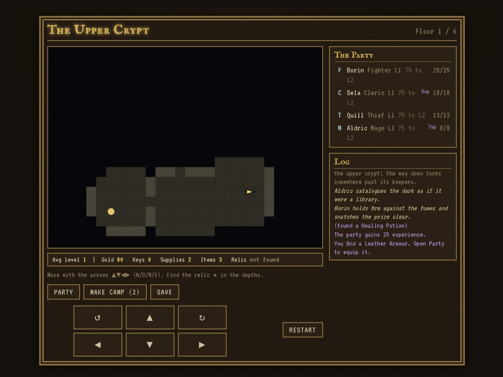

# Gold Box — Crown of the Sunless King

A single-file, browser-based tactical RPG in the spirit of the classic SSI Gold Box games. Four heroes descend beneath a ruined kingdom to recover the Sunless King's crown and bring back the dawn. Play **The Last Dawn**, a six-chapter campaign: explore a fogged dungeon, rally a kingdom, make lasting war-council decisions, and decide the fate of the Sunless King’s crown.

The whole game is one HTML file. No build step, no install, no dependencies. Open it and play.



## Play

**[▶ Play it now](https://cisohabitat.github.io/Gold-Box/)** · **Build 0.25.0**

Or just open `index.html` in any modern browser. It works offline (the only network calls are optional Google Fonts; without them it falls back to system fonts). The layout adapts to the screen — a fitted board/control shell on every device, with a live sidebar in wide windows and a separate Party & Log panel in smaller windows. **How to Play** on the title screen explains the rules.

Balance diagnostics remain in the repository for maintenance; the game does not link players to the report.

The live version is served from GitHub Pages: the repo’s **Settings → Pages** source is set to the main branch root. Changes on a pull request branch become live only after they reach `main`; download that branch's `index.html` to play its version locally.

### Enemy placement

Build 0.23.0 keeps every newly placed enemy on ground reachable before the stairs, including guardians. Ambushes and awakened patrols also respect locked doors and never reuse cleared fights. Loading an older map repairs inaccessible surviving enemies without resetting cleared battles or treasure. Six placement regressions include an independent audit of 2,048 generated floors.

### Exploration and leaving a floor

Build 0.25.0 reduces unnecessary quest travel: Warren scouts fit into the key outing, and the Gallery’s three name stones follow a more efficient walking order. Where useful, a newly generated map gains up to two short service passages; a blue arch appears once its terrain is seen. Locked vaults and secret caches remain protected. Existing saved maps and task labels stay intact.

**Before leaving this floor** appears in the waystation, final crown review and Chronicle. It lists unfinished objectives and known unclaimed finds with coordinates; discovered hidden caches keep their contents a surprise. Use **Return to floor** from the waystation or crown review to finish exploring. Chapter XP, council choices and treasure stay once-only. An explicit crown fate still finishes the campaign; loading while on the final stairs reopens its review.

### Tactical chapter battles

Build 0.24.0 places bow patrols along long lanes, split watches at junctions and support groups near treasure approaches, while keeping enemies reachable before the stairs. Each of the eight map nodes has a named signature ordinary arena: the Lantern Gate, Blackwater Sluice, Hall of Unspoken Names, Cinder Foundry, Legion’s Broken Causeway, Pilgrims’ Last Wells, Ashen Switchback and Mirrors Before Morning. Guardian arenas stay intact.

**Optional field objectives:** select a numbered diamond to preview its affected tiles. From on or adjacent to it, press **Confirm** to spend one hero action raising cover, lighting sanctums or quenching embers. Each diamond works once per battle; the changed terrain helps either side. You can ignore these objectives and win by defeating all enemies. They grant no extra XP or treasure. Tactics gives the full briefing and coordinates; Auto only claims an adjacent objective when it immediately helps an ally already on an affected tile. Newly generated maps carry these scenes; older saved maps keep their existing encounters. Battle progress remains unsaved, as before.

### Sprite art

Build 0.19.0 redraws all 26 pixel sprites: four heroes, 21 monsters and the company standard. Smaller heads, varied stances, shaded equipment and brighter focal details replace the old block-shaped figures. Guardians have a cathedral-armoured bell knight, a flame-crowned cantor, an eclipsed king and a spread-wing star dragon. Round hero frames, square enemy frames, HP rails and guardian warnings remain visible. Matching art appears on the board, roster, Tactics and Bestiary; Tactics provides a larger view on phones. [Sprite review and contact sheet](SPRITE_REVIEW.md) document the designs and remaining limits.

### Presentation and player options

Build 0.8.0 adds themed materials, chapter and ending illustrations, battle/victory cues, and actual HP-change feedback. Hover or keyboard-focus a combat tile to inspect HP, AC, range, and legal attack odds. Feedback is decorative and never delays an action.

Open **Sound & Display** from the title or Party & Log. Choose high contrast, reduced visual effects, normal/quick Auto pace, volume, and optional synthesized sound and ambient tones. Sound and ambience start off; enabling them requires a gesture and downloads no assets. Preferences persist separately from the campaign, or last for the session when storage is blocked. Settings pause combat; Escape returns to play. OS reduced motion always takes priority.

The quality target is an excellent small standalone tactical RPG. The fresh overall grade is B+; the size target is now a soft 350 KiB, and commercial AAA production remains outside this project’s scope. Physical iPhone/iPad validation and broader human balance/playtesting remain outstanding.

### Guardian counterplay — build 0.13.0

The Bell Warden channels its rallying toll for one active turn; a damaging weapon hit breaks the chant and spends its charge. The Ash Cantor marks a fixed 3×3 Cinderburst one active turn ahead: leave the amber tiles or interrupt with a weapon hit. Misses and spell damage do not interrupt. Incapacitation delays release; death clears the warning. Ordinary casters still cast immediately.

The boss bar, outlined caster, labelled grid tiles and Tactics explain imminent threats. Auto seeks legal safe ground before acting and still takes movement reactions. Astrax has 46 base HP and a 3d6 Starless Breath; its breath remains uninterruptible, with a fixed warning area and bounded half-health recharge. Move out before it releases.

### Playing on desktop, iPad, and iPhone

The play area adapts to the current browser height, including Safari's expanding or collapsing bars, and leaves safe-area space around the display cutout and home indicator. In portrait, the board sits above the action buttons and movement pad. In short landscape windows at least 600px wide, the board and controls sit side by side. In very small portrait windows the play panel can scroll, keeping the board at least 160px tall and every action reachable. The boss bar and horizontally scrollable spell menu fit inside that same play area.

**Restart** now asks before returning to the title screen. **Keep Playing** is selected first and remains available immediately. The return-to-title button waits 600 ms before enabling to reject a rapid second tap; Escape cancels, and combat pauses while the question is open. Confirming preserves your latest exploration save for Continue, but an in-progress battle is not saved. The build number appears on the title screen and gameplay header.

The two latest events stay visible beneath the board, during exploration and combat. The full history remains available in **Party & Log** (labelled **Log** in very narrow landscape windows). Combat also shows the active hero and whether movement and the action are ready or spent.

Tap **Party & Log** to inspect the roster and battle history, then **Back to Game** to return. This panel replaces the sidebar on phones, most iPad windows, and smaller desktop windows. Windows at least 1200×650 pixels keep the live sidebar. iPad split view and rotation adapt without restarting the run. Equipment, creation, save, and other menus scroll independently when their contents are taller than the screen. Main action and movement buttons have touch targets at least 44 pixels across and tall; pinch zoom remains available.

Use a mouse or touch to choose actions. With a keyboard, explore using arrows or WASD; in combat, Tab to the grid, move focus with arrows, and press Enter or Space to use the selected action. Area spells still require confirmation. Focus a flagged enemy during Attack to see its hit chance. Score assignment, equipment slots, and level choices accept Enter/Space too; open menus keep focus inside and return it when closed. Reduced-motion preferences disable animations and transitions.

The layout was checked at 440 × 956, 440 × 780, and 440 × 680 portrait viewports, 956 × 440 and 956 × 350 landscape viewports, and 390 × 844, with simulated safe-area insets. These are Chromium viewport checks for iPhone-sized screens, not physical iPhone or Safari certification. Reload the live page after an update to get the latest layout.

## The game

You lead a party of four down through a six-floor dungeon, picking your route at each fork. Defeat the Bell Warden in the Catacombs and the Ash Cantor in the Descent. The crown rests in the deepest tomb; lifting it wakes roaming dead, turning the last stretch across that floor into a fighting retreat. Defeat the Crypt Lord, reach the final stairs, then choose whether to break, bind, or wear the crown. Choose which hero bears its oath if you bind or wear it.

Every floor is generated fresh each run, so the layout, loot, and encounters change every time, while the arc stays the same.

### The Last Dawn campaign

Captain Ilyra holds the last gate. Archivist Eren has discovered where the king imprisoned every lost sunrise. Your four heroes descend through six chapters, with two route forks changing the places, people, and choices you encounter:

1. **A Kingdom Without Morning** — open the refugee road or recover the royal arsenal.
2. **The Drowned Standard / A Thousand Forgotten Names** — send Nessa beneath the throne, recover the drowned pay, carry the lost register, or take the ancestral vigil, depending on your route.
3. **The Bell That Commands the Dead** — free the bound choir or forge the Bell Warden’s iron into weapons.
4. **The Legion Beneath the Mountain / The Procession of Small Gods** — rally the lost legion, bear its shields, relight village hearths, or carry the procession’s ward.
5. **The Last Fire** — send Ilyra’s survivors against the throne or carry the final ember yourselves.
6. **The Throne at the End of Night** — defeat the king and decide what replaces his rule.

At each of the five waystations, a **War Council** appears before the trader. Read both plans and their exact benefits, then commit to one before descending. There are seven authored councils across the branching world and fourteen possible plans; one run encounters five councils. Supplies and permanent bonuses help on the road. Other choices weaken the final king, draw away part of his retinue, deny one bloodied-phase reinforcement, or grant a three-turn opening ward. The battle log explains your allies’ help. Decisions and rewards save immediately and cannot be claimed twice; Chronicle recalls the road and its consequences.

The finale offers three distinct endings: **Break** releases the dawn, **Bind** leaves your chosen hero as Warden, and **Wear** places your chosen hero on the throne. The epilogue remembers the named company, refugees, both route forks, the choir or bell-forged weapons, the shrines or legion, and the final ember or vanguard. Legacy chapters receive no invented choice outcomes. The choice only opens with the crown, the king defeated, and the final stairs reached. Reloading before you choose returns to that decision. Older portable saves remain supported; earlier chapters receive no retroactive story rewards.

The Ash Cantor’s supporting force has a slightly smaller encounter budget (0.55 → 0.50); its own stats, spells and second phase retain their full strength. This targets the measured pre-finale difficulty spike.

Guardian victories now pause on an illustrated aftermath before the journey resumes. Pending level choices appear first; then read the aftermath and choose **Carry the story onward**, or press Escape. Stairs resume automatically after acknowledgement. The Chronicle preserves guardian aftermaths after Continue/import using existing campaign progress. No new save version is required.

Eclipsescale reduces each damaging spell hit by 2, down to zero, including friendly fire. It does not block weapons, poison, terrain damage, or spell statuses. Its +2 AC trades raw armour against Starweave’s +3 AC; Auto Gear prefers its protection when AC is equal, and manual equipment remains available.

### Different goals along each route

Build 0.12.0 gives the four branching chapters their own map objectives. Each run encounters two of them:

- **Warren:** find the blue **S** beacon, then escort the scouts back to **C**, the entrance camp. Scouts travel with the company; there is no separate unit to manage.
- **Gallery:** read the three blue name stones in order **1 → 2 → 3**. A later stone waits until the preceding name is recovered; it never resets your progress.
- **Ossuary:** recover Dawnblade at **D**, then carry it to the legion’s standard at **C**. Raising the standard keeps the sword in your equipment or satchel.
- **Pillared Road:** step onto any two shrine beacons to restore them. **B** gives one camp supply; **R** restores up to 4 HP per hero; **M** restores one spent spell charge per hero. Stepping onto a shrine commits that choice. Each pays once; after two, the remaining shrine stays dark.

Eren’s map marks the blue beacons through fog without exposing enemies or corridors. Use the movement controls to reach them. The main objective shows progress; **Chronicle** holds the full briefing. Finish the chapter objective before using its exit, then make the existing waystation council choice. Camps and targets are reachable before unlocking the vault. Completing an objective gives its story outcome, not additional XP; the existing chapter XP still pays once.

Progress, shrine choices and completion survive Continue and portable codes. Old v2 saves keep their current generated floor without a new objective; subsequent route floors use the new goals. No extra enemies or timers are added. The unused first-person drawing code has been removed to keep space for gameplay within 350 KiB; the overhead map and movement controls remain.

### Relic artwork

Build 0.10.1 replaces the shared weapon/cloak/potion pictures with 16 individual treasure illustrations. Dawnblade carries a sunburst, Nightglass has a hooked glass blade, Starweave bears constellations, Eclipsescale preserves a winged dragon scale, and the Sunless Crown holds a chained sun. Legendary relics have larger framed displays. Every ordinary item also has its own silhouette. [Artwork review](TREASURE_ART_REVIEW.md) records the designs and checks.

### Bestiary, treasure and the Star-Eater

Open **Bestiary** or **Treasure & Relics** on the title, in **Party & Log**, or at a waystation. The illustrated field guide covers all 21 creatures with lore, base statistics, spells, habitats and counterplay. The treasure page covers all 27 items plus the Sunless Crown, with exact effects, usable classes, sources, current carried counts and equipped heroes. Search and category filters help find an entry. The complete guide contains campaign spoilers. Combat pauses while it is open; Back or Escape resumes the same battle and preserves spell aim.

**Legends & Hunt** introduces Astrax, the Star-Eater, a sky-dragon chained beneath the Observatory of Ash. Its hunt opens at a waystation after four chapters and the current council choice. Rest and equip first. Starless Breath marks nine amber tiles, then strikes them on the dragon’s next active turn: move out before it releases. At half health it gains attack, restores one breath charge and summons one skeleton once. The hunt is optional; victory gives the Eclipsescale Mantle (+2 AC and 2 less damage per spell hit, any class), a supply and battle XP once, returns the company to the waystation, and changes the final story acknowledgement. Defeat ends the run. Restart during the battle preserves the latest pre-hunt town Continue when storage is available.

The campaign now adds route-specific set pieces, guardian aftermaths and a dragon omen carried through to all three endings. The War Axe is available from the trader. [Campaign review](CAMPAIGN_REVIEW.md) records the scope and validation limits.

### Features

- **Battlefields with rules.** Crypt, Catacomb, and Tomb fights have distinct terrain layouts. Cover gives +2 AC against ranged weapons; spells and melee ignore it. Sanctums restore up to 3 HP at turn end. Embers deal 2 damage at turn end and can knock a unit out. Both sides follow the same rules, and the AI considers terrain when moving.
- **Readable tactics and safe aiming.** Open **Tactics** during combat to pause and read enemy roles, current stats, remaining spells, and statuses. Area spells require an aim tap followed by a second tap or confirmation. The blast is highlighted and the confirmation reports allies and foes in the area, including a friendly-fire warning for damaging spells.
- **A reward for every chapter.** Each nonfinal chapter exit grants every hero `100 + 50 × floor tier` XP once. It remains separate from survivor-only battle XP on harder oaths. Exits resume after combat and pending level choices without requiring a step off the stairs.
- **Promises to the kingdom.** Chronicle tracks three optional contracts. Win four battles for Sunshard (Mage/Cleric weapon, +2 attack/+2 damage); open two hidden caches for Lantern Mantle (+2 AC); succeed at three event checks for 120 gold and two supplies. Rewards are automatic, saved, and paid once. Skips and failed checks do not count as successes.
- **Guardians before the finale.** The Bell Warden rallies its retinue; the Ash Cantor uses hexes and fire. Each gains a small buff and calls one skeleton at half health while alive. Their capped encounter budgets keep these milestones within the existing campaign. The Crypt Lord retains its stronger two-skeleton phase.
- **Choose your oath.** Wanderer starts selected: smaller enemy forces, 25% party HP recovery after victory, and victory XP for downed heroes too. Delver uses the standard encounter multiplier and survivor-only battle XP; Ironbound increases that budget by 25%. Elite rolls and party strength still affect the result.
- **Class signatures.** Each hero has a special action usable once per battle. Fighter: Rally the Line (+2 party attack and AC for two turns). Cleric: Dawn's Mercy (heal all standing allies for 6 + twice the Cleric's level). Thief: Cloak of Shadows (+4 AC and weapon damage for three turns). Mage: Arcane Wellspring (restore one use per spell and gain +2 AC for two turns). Buff durations tick at the affected actor's turn end. Signatures spend an action, and Auto uses them too.
- **Embers of the old kingdom.** Each waystation offers three of the remaining blessings. Claim one free blessing there: permanent party attack, armour, or damage bonuses, or immediate supplies, gold, or potions. Each blessing is unique within a run. You may descend without claiming one.
- **Legendary finds.** Find Dawnblade in the Ossuary, Starweave Mantle on the Pillared Road, and Nightglass in the Sunless Tomb. The first fork and second fork still determine your route and rewards.
- **A king who fights back.** The Crypt Lord gains attack and damage and calls two skeleton guards when reduced to half health while still alive. A boss HP display marks the phase change. Escape requires both the crown and the king's defeat.
- **A chronicle of your company.** Track your route, oath, blessings, battles, defeated foes, steps, secrets, and resolved events. The ending remembers your run.
- **Branching world.** Six floors over one of four routes, forking twice and reconverging. Each fork is a real choice between a fight-heavy, loot-rich path and a quieter, supply-led one.
- **Tactical grid combat.** Turn-based battles with movement, attacks of opportunity, ranged penalties in melee, spells (damage, healing, area blasts, control, buffs, debuffs, summons), and a full enemy AI. An auto-fight toggle plays out a battle for you.
- **Four classes.** Fighter, Cleric, Thief, and Mage, each with its own stats, growth, and build path. Roll your own party or jump in with a pre-made one.
- **Per-character progression.** Each hero earns its own XP and levels independently up to level 8. On Delver and Ironbound, heroes knocked out in a fight miss that battle's XP; chapter XP goes to everyone. Every level grants one ability bump plus a build choice (learn a spell or take a perk). Pending level allocations survive saving and reloading.
- **Exploration that rewards your stats.** Line-of-sight fog, a Dexterity-driven scout radius, and twelve stat-check events spanning all six abilities. Hidden wall caches reward a perceptive (high-Wisdom) party — find them by walking past, or miss them entirely.
- **Backgrounds.** Each hero has an origin with a small mechanical edge and in-character barks at story beats.
- **Self-scaling difficulty.** Encounter strength is budgeted from floor tier, party level, equipped gear, and oath, with tougher “elite” foes appearing on deeper floors. Gear contributes 0.12 budget per gold of equipped value, reduced from 0.5 so modest upgrades no longer add disproportionate forces. Full Auto is convenient but does not guarantee victory; positioning, equipment, route choices, and supplies still matter.
- **Portable saves.** Save to a copyable code that works anywhere, plus an automatic browser save with a Continue button when storage is available.

### Controls

- **Move** with the on-screen compass pad, or the arrow keys / WASD on desktop. The party faces the way it steps.
- **Explore** to reveal the map, pick up loot, trigger events, and find the stairs down. Foes engage when you step adjacent.
- **Fight** with the current hero in initiative order, then move and act (attack, cast, guard). Or hit **Auto** to let the party fight on its own.
- **Waystation** between floors: rest, shop, manage equipment, and choose your next path.
- **Signature** uses the current hero's class ability. Its explanation appears below the board while available; the button disables after use.
- **Chronicle** opens your route and run statistics during exploration.
- **Tactics** replaces Chronicle during combat and pauses the turn loop while its guide is open. Close it to resume.
- **Area spells:** the first tap aims; a second tap on the same tile or the confirmation button casts. A different tile changes the preview without spending a charge. Single-target spells retain one-tap casting.
- **Party & Log** opens the roster and battle history on phones; **Back to Game** closes it. In portrait, use the four-arrow movement pad. Desktop turning controls and keyboard movement remain available.

## How it’s built

The codebase is deliberately structured so content is **data**, and game logic never touches the screen:

- Two pure engines — `CombatEngine` (grid combat) and `ExploreEngine` (dungeon) — hold all the rules and return plain typed signals. They never read or write the DOM.
- A single controller layer owns the screen and the state machine, reacting to those signals.
- Content lives in **registries**: `SPELLS`, `ITEMS`, `PERKS`, `CLASSES`, `BESTIARY`, `EVENTS`, `OATHS`, `BOONS`, `SIGNATURES`, `TERRAIN`, `BATTLEFIELDS`, `CONTRACTS`, the `WORLD` graph, and the `DIFFICULTY` / `XP_TABLE` tuning tables. The controller keeps campaign statistics and applies blessing bonuses to hero data before combat.

This means most changes — a new spell, monster, item, perk, event, or whole floor — are a new entry in a registry, not new engine code. See [AGENTS.md](AGENTS.md) for contributor guidance, validation expectations, and the areas identified during review.

### Add a floor (example)

A floor is a node in the `WORLD` graph. It describes *what* the floor contains, not how it’s laid out — the generator produces a fresh, solvable map every run:

```js
my_vault: {
  id: 'my_vault', name: 'The Forgotten Vault', theme: 'tomb',
  gen: { cols: 4, rows: 3 }, tier: 2,
  lockedExit: true, key: true,
  gold: 100, rations: 1,
  items: ['oak_staff', 'potion_heal'],   // loot to scatter
  events: 3,                             // stat-check events to place
  secrets: 2, secretItems: ['potion_heal'],  // hidden wall caches
  encounters: [ { pool: ['skeleton', 'necromancer'] } ],
  teaser: 'Quieter going, but the walls hide more than dust.',
  next: ['deep_stair']                   // successor floor id(s); [] = finale
}
```

Give a node more than one `next` to create a fork; the waystation offers the choice automatically. Paths can reconverge (it’s a DAG, not a tree).

## Run locally

No tooling required. Clone the repo and open the file:

```bash
git clone https://github.com/cisohabitat/Gold-Box.git
cd Gold-Box

open index.html        # macOS
xdg-open index.html    # Linux
start index.html       # Windows
```

Or serve it (handy for testing the auto-save, which some browsers gate behind `http://` rather than `file://`):

```bash
python3 -m http.server 8000
# then visit http://localhost:8000
```

## Save compatibility and fixes

Existing version 2 portable codes still load. Saves without campaign fields default to Delver with no claimed blessings or historical counters. An already-cleared Crypt Lord encounter is recognised when loading an older final-floor save. New saves retain the oath, blessings, statistics, and pending level allocations. A lost allocation from an older save cannot be reconstructed retroactively.

The tactical-depth release adds chapter completion, contract IDs, and successful-event counts to the same version 2 payload. Older saves infer previously completed chapters from their route and town state without awarding retroactive chapter XP. Successful-event history starts at zero when absent. Contract rewards already recorded in a new save cannot be collected again.

Malformed imports are validated and prepared before replacing the active run. Newly generated cache walls cannot bypass sealed vaults. Supply pickups preserve their configured amount: the quiet Gallery and Pillared Road each provide two, while legacy pickups without an amount still give one. Existing saved floor layouts are preserved rather than regenerated.

The four defects reproduced in the October 20, 2026 review are addressed in this version:

- Combat and event level-up allocations persist and reopen on load.
- Auto uses one active turn timer and invalidates callbacks when combat or the menu state changes.
- Auto area-damage spells reject targets that would hit allies; manual casts still permit friendly fire.
- Archer retreat triggers opportunity attacks before the archer can shoot.

Casters also advance to spell range instead of charging into melee, and incapacitated actors cannot perform attacks, movement, spells, or signatures.

## Validation

The current dependency-free suite has **114 engine/controller checks** against the real inline script with DOM stubs. It covers save recovery, pending levels, atomic imports, turn scheduling, friendly fire, guardians, campaign gates, route goals, movement-risk forecasts and immediate inventory persistence. Generator checks include 96 exit/key layouts, 160 all-cache-open vault layouts and 256 objective/fallback layouts.

Browser suites exercise real touch/keyboard controls, save/Continue, offline interaction, clipboard failure, paused menus, all endings, atlas/hunt recovery and 25 viewport sizes. The confidence suite reloads before closing Party after equip, unequip, Auto Gear and healing; it also checks full-HP potion safeguards and movement/turn previews on phone, short landscape, iPad-sized and desktop windows. Automated WebKit is compatibility evidence; physical iPhone/iPad Safari and human campaign difficulty remain unverified.

Serve the game locally and use the release commands below. DOM-stub tests do not replace browser or hardware checks. Direct file:// browser automation is blocked by the managed browser policy; local HTTP and offline-after-load interaction are tested.

## Repository

- `index.html` — the complete game (one file).
- `AGENTS.md` — contributor instructions, architecture boundaries, and regression guidance.
- `README.md` — play instructions, architecture overview, save compatibility, and validation checklist.
- `tests/regression.cjs` — dependency-free behavioral regression checks.
- `REVIEW.md` — baseline findings and reproduced defects.
- `ROADMAP.md` — bounded delivery stages and explicitly deferred work.
- `REQUIREMENTS.md` — detailed rules, acceptance criteria, and validation record.
- `Gold-Box.JPG` — the gameplay screenshot above.

## Credits & licence

Built as an homage to the SSI Gold Box engine of the late 1980s. This is an original implementation — no original assets or code are used.

Add a licence of your choice (e.g. [MIT](https://choosealicense.com/licenses/mit/)) by dropping a `LICENSE` file in the repo root.


### Optional device checks

With Playwright available to Node and Chromium at `/usr/bin/chromium`, serve this directory with `python3 -m http.server 8000`, then run `node tests/devices.cjs`. Set `GOLD_BOX_URL` to check another served URL. The game itself needs neither tool. The matrix covers 25 phone/tablet/desktop window sizes, including iPad split view and short desktop windows; it checks fitted exploration/boss/spell layouts, 44px controls, keyboard grid focus, independently scrolling menus, resize state, reduced motion, and page errors. These are Chromium checks; actual Safari and physical-device testing remain unverified.


### Release quality checks

With the local server running and development browser tools installed:

```bash
node tests/regression.cjs
node tests/balance-checks.cjs
node tests/sprites.cjs
node tests/scenario-balance.cjs
node tests/devices.cjs
node tests/quality.cjs
node tests/polish.cjs
node tests/sprite-browser.cjs
node tests/flow.cjs
node tests/epic.cjs
node tests/campaign-payoff.cjs
node tests/objectives.cjs
node tests/atlas.cjs
node tests/guardians.cjs
node tests/confidence.cjs
node tests/arenas.cjs
node tests/patrols.cjs
node tests/enemies.cjs
node tests/projectiles.cjs
node tests/companions.cjs
node tests/balance.cjs
node tests/companion-campaign.cjs
```

These suites cover input safety, storage recovery, campaign choices, route objectives, guardian counterplay, illustrated content and tactical feedback. The release balance gate drives 96 fresh campaigns across all oaths/routes using real controllers and Auto combat; `tests/campaign.cjs` offers a shorter 36-run diagnostic. Read current results in the repository's BALANCE.md; previous release samples are historical evidence, not current win rates.

The **Game quality** GitHub Actions workflow runs engine, device, quality, flow, and epic-campaign checks on Chromium, Firefox, and WebKit; Chromium also runs the expanded 96-campaign balance gate and uploads build-tagged JSON/Markdown results. Before automatic merge/publication, wait for every PR quality job to pass and verify the final Pages deployment. This is the release procedure; branch protection has not been configured by this change. Use `GOLD_BOX_BROWSER=firefox` or `webkit` for development checks with those Playwright browsers installed. `CHROMIUM_PATH` overrides the browser executable for CI/local installations. WebKit automation is useful compatibility evidence; physical Safari on an iPhone/iPad and real hardware performance still require manual testing.

For hardware validation, try portrait/landscape, browser-bar resizing, iPad split view, pinch zoom, opening/closing each menu, aimed spells with allies nearby, browser Continue, and a save-code transfer between devices. These cannot be certified from this environment.


### Game balance check

Balance diagnostics are recorded in the repository’s BALANCE.md and CI artifacts. The game and README Play line do not link to the report. Run `node tests/balance.cjs` against a served game for 96 campaigns across all oaths and routes. It uses the real game engines with default heroes, Auto combat, loot-first exploration, camping below 70% HP, the first offered boon, varied councils, and no shopping. The report includes win-rate uncertainty, route results, defeat floors, guardian rounds/HP pressure, and every run’s seed. It is a reproducible regression canary, not a human win-rate estimate.

The gate rejects stalls and invalid endings, inverted difficulty, a route with no Wanderer win, and broad oath-specific balance failures: Wanderer below 50%, Delver outside 10–90%, Ironbound without a win or above 60%, or more than 25% of Wanderer runs dying on the first floor. These limits are deliberately broad; the policy and sample remain limited. `BALANCE_SAMPLES=12 node tests/balance.cjs` expands to 144 campaigns. Reports default to `artifacts/balance/`; `BALANCE_OUTPUT` overrides that directory. Failed checks retain their reports for investigation. The dependency-free `node tests/balance-checks.cjs` verifies the gate itself.


### Manual-play clarity and recovery — 0.13.1

Tactics opens at the top with a sticky Return button, keeping threats readable and keyboard focus visible. It shows the next twelve living units in current turn order, their sides, round boundaries and incapacitated turns. Wait and new summons may change the forecast. During Move, amber **!** markers identify destinations that provoke free weapon strikes, sit in a marked blast, or contain embers. Hover or keyboard-focus a tile for the risk details; a marker warns without preventing a deliberate move. Forecasts use the same reaction checks as movement and do not roll dice.

Equipping, unequipping, Auto Gear and exploration healing now autosave immediately, including while Party remains open. Reload/Continue keeps the updated gear, HP and satchel together when browser storage is available; portable codes remain the fallback when storage is blocked. Full-HP heroes keep a healing potion and their combat action. The combat menu labels that potion Full HP and disables it until healing is useful. Fury potions keep their existing rules.

Fresh scope grade: **B+ overall**. Reliability and clarity improved; encounter variety, human-tested difficulty and physical-device evidence still limit a higher grade. See REVIEW.md for findings and the release PR for exact-head cross-browser/publication evidence.

Build 0.13.1 local evidence: 75 engine/controller checks, four sprite/art checks and four balance-policy checks pass; all eleven Chromium browser suites pass. The 96-run canary remains 27/32 Wanderer, 16/32 Delver, 10/32 Ironbound with no stalls. Runtime 347,155 bytes (<350 KiB). Exact-head cross-browser and live publication results are recorded in the release PR; physical Safari/human difficulty remain unverified.

### Guardian battlefields and relic builds — 0.14.0

350 KiB is a **soft size target**. Useful features may exceed it; byte count is reported instead of blocking the release. Offline play, no runtime packages, old saves and phone/tablet/desktop usability remain requirements.

The Bell Warden holds the **Nave of the Last Bell**, with covered approaches and healing anchors; breaking its bell reveals two more sanctums. The Ash Cantor's **Choir of Living Ash** has ember aisles and two outer refuges; the final hymn ignites the inner aisle. In the **Throne of the Stolen Dawn**, the King's wrath turns four central tiles into embers while the western refuge remains. Astrax's **Observatory of Broken Stars** ignites four star-fall tiles at half HP. All changes occur once, use normal end-turn terrain rules and are described in paused Tactics. They do not deal immediate damage. Ordinary battles keep their themed layouts.

Existing council choices now have visible battlefield support: the lantern road and remembered names each light one additional Bell sanctum; the freed choir shelters two Cantor tiles, even through its final hymn. These come from your saved choice, add no new claimable rewards and do not replace existing final-battle consequences. Previews, battle logs and Tactics identify the help.

**Choose armour for the threat:** Lantern Mantle is +2 AC and blocks up to 2 damage from terrain embers; Starweave is +3 AC and +2 saves against spell control/debuffs; Eclipsescale is +2 AC and reduces every damaging spell hit by 2. These are distinct protections: Lantern does not stop fire spells, Starweave does not stop poison, and Eclipsescale does not stop terrain fire. Select an item in Party to compare it with each hero's equipped item, including the passives being replaced. Atlas build notes explain weapon bonuses versus spell power. Auto Gear does not infer every situational preference.

Heroes who fall during their own move or friendly-fire spell now yield automatically to the next living unit. Players no longer need to end a dead hero's turn.

`tests/scenario-balance.cjs` adds 288 deterministic isolated-arena probes with two squads, plain/ward gear fixtures, guardian-first/retinue-first front-line priorities, three oaths and three seeds. Casters/enemies still use Auto. Fixture equipment does not prove acquisition, and these are not human playtests or full-campaign win rates. `tests/arenas.cjs` verifies actual movement/spell death recovery, terrain shifts, council support, gear comparisons and save recovery at four device sizes.

Build 0.14.0 local evidence: 84 engine/controller checks, four sprite/art checks and four policy checks pass; all twelve Chromium browser suites pass. The full 96-campaign canary gives 28/32 Wanderer, 23/32 Delver and 15/32 Ironbound with zero stalls and unchanged thresholds. All 288 isolated strategy scenarios terminate; 72 prepared Observatory hunt probes win. Runtime 354,308 bytes (346.0 KiB), reported against the soft 350 KiB target. Exact-head cross-browser/publication evidence is recorded in the release PR. Human/physical-device limits remain open.

### Patrol tactics and learning from defeat — 0.15.0

Ordinary encounters now deploy as five patrol patterns: **Shield & Bow**, **Split Watch**, **Hex Cell**, **Rallying Warband** and **Grave Procession**. They use existing enemies and the same encounter budget/count cap. When affordable, a group reserves two complementary roles before filling its remaining budget; elites cannot spend the budget reserved for the second role. Small groups fall back safely. Rear attackers and support units deploy behind staggered or split front ranks. A lone sentry gets no misleading formation name, and a group missing its intended specialist falls back to Split Watch.

The opening log and paused Tactics name the pattern, explain a counter and list the living enemies' roles. Formations change starting positions, not line of sight or movement/attack rules. Bosses keep their own composition/arenas. Older v2 encounter descriptors derive a suitable pattern from their existing pool; new descriptors save their authored pattern, and invalid pattern IDs are rejected before changing a run.

After a loss, **Learn from this battle** shows the starting party HP, actual HP lost to weapons/spells/embers/poison, friendly-fire contribution, missed weapon strikes, turns lost to Sleep/Hold and the first hero to fall. Overkill is excluded and protective wards are accounted for. Friendly fire is already included in spell damage, not an extra damage total. Weapon strikes include reactions. The report offers at most two suggestions based on what was observed; it does not claim that one statistic explains the entire defeat. Feedback appears before run totals, with readable focus, independent scrolling and the existing Play Again action. New runs and victories clear it.

This evidence is local to the completed battle, uses no extra dice rolls and is not saved or sent anywhere. The existing defeat/save rules are unchanged. Full campaign balance, device checks and cross-browser CI remain release gates; physical Safari and human campaign playtesting remain outstanding.

Build 0.15.0 local evidence: 92 engine/controller checks, four sprite/art checks and four policy checks pass; all thirteen Chromium browser suites pass. The full 96-campaign canary gives 24/32 Wanderer, 24/32 Delver and 7/32 Ironbound, with zero stalls and unchanged criteria. All 288 guardian probes terminate, with unchanged outcomes. Runtime 363,723 bytes (355.2 KiB), slightly above the user-approved soft 350 KiB target. Exact-head cross-browser and live publication evidence is recorded in the release PR. Human/physical-device limitations remain open.


### Six new enemy roles — 0.16.0

The bestiary now holds **21 enemy types: 17 regular enemies and four guardians**. Six new creatures appear gradually in ordinary chapter pools, with distinct 24×24 sprites, lore, habitats and exact counters in Bestiary and Tactics. The first chapter and guardian retinue pools retain their previous creatures. Existing generated saves keep their encounter pools.

| Enemy | What changes the fight | Counter |
| --- | --- | --- |
| Shield Sentinel | Other adjacent allies gain +2 AC against weapons; several sentinels do not stack the bonus. | Separate allies, disable the bearer with Sleep/Hold, or use magic. Weapon previews include the ward. |
| Crypt Stalker | One leap per battle, up to four tiles onto a free square beside a vulnerable hero; movement spent, then a normal attack. | Guard intercepts the landing; leaving melee still provokes. Keep casters protected. |
| Ember Wisp | Death marks a fixed 3×3 blast for 4 spell damage to both sides at the start of round N+2, where N is the death round. | Everyone gets a full round to move. Amber tiles, log and Tactics name the exact round; Auto evades. Victory disperses sparks. |
| Spellbreaker | Two range-four Silence charges: Wisdom DC 13, spells blocked for two active turns on failure. | Weapons, signatures and potions remain available. Starweave improves the save. No blocked spell charge is spent. |
| Grave Leech | Three range-four siphons deal 1d4+1 spell damage; one wounded ally within three tiles recovers up to three actual HP lost. | Focus the leech or separate its allies. Eclipsescale reduces damage and the healing it can fuel. |
| Chain Warden | Two range-four hooks deal 1d4 spell damage and pull a surviving target one tile toward the gaoler if free. | Avoid unsafe ground near its reach. Forced pulls do not provoke or spend the target’s movement; terrain ticks at turn end. |

Warren introduces stalkers; Gallery introduces sentinels; Catacombs adds funeral wisps. The fourth-chapter routes introduce siphoners, silencers and chain gaolers. Deeper ordinary patrols mix these roles within existing threat budgets and the eight-enemy cap. No new floor, map gate, action button, save version or runtime dependency is added.

The six sprites were visually inspected together for distinct silhouettes. Automated checks cover ability boundaries, protection and damage evidence, round timing, movement reactions, silence expiry, old/new saves and four device classes. Human full-campaign balance and physical Safari testing remain outstanding; the overall assessment remains B+.


Runtime for 0.16.0: **377,562 bytes (368.7 KiB)**, +13,839 bytes (13.5 KiB) over 0.15.0. This exceeds the soft 350 KiB target in exchange for six mechanics, six sprites and their field-guide content; there are no new runtime dependencies or downloaded assets. Final campaign/CI/publication evidence is recorded in BALANCE.md and the release PR.

Build 0.16.0 local evidence: 102 engine checks, four sprite/art and four policy checks, 288 guardian scenarios and all fourteen Chromium browser suites pass. Full 96-campaign Auto canary: wanderer 25/32, delver 20/32, ironbound 13/32; zero stalls, all existing criteria pass. Runtime 377,562 bytes (368.7 KiB). Exact-head cross-browser CI and Pages/live evidence are recorded in the release PR.


### Visible arrows and spell flight — 0.17.0

Ranged weapon attacks now send a visible arrow from the attacker to the target, including a glancing miss marker. Confirmed spells travel to their actual target tile: flame, ice shard, healing cross, control rings, chain hook, ward and arcane bolt use distinct shapes and colours. Self-centred spells pulse in place. Preparing an aim or a guardian channel creates no shot; the projectile appears when the spell releases.

Effects survive normal board/turn redraws without replaying. They are decorative and do not delay damage, block input, spend resources, roll extra dice or change turn timing. Up to six effects can overlap; they clean up within 720 ms. Menus, resize, hidden tabs, title/load and leaving combat clear them. **Sound & Display → Effects** disables them, and OS reduced motion suppresses them. The combat log and HP values remain authoritative, including when a battle-ending hit immediately opens its result.

Phone screenshots were visually reviewed. Browser checks cover actual arrow misses, real Fireball aim/confirmation, intermediate flight position, target snapshots, distinct spell shapes, self pulses, rerender persistence, cleanup/caps and accessibility preferences at phone portrait, short landscape, tablet and desktop sizes. Physical Safari remains unverified. Runtime: 384,016 bytes (375.0 KiB), +6,454 bytes over 0.16.0, under the existing soft-size policy with no new dependency or downloaded asset.

Build 0.17.0 local evidence: 106 engine checks, four sprite/art and four policy checks, 288 guardian scenarios and all fifteen Chromium browser suites pass. Full 96-campaign Auto outcomes remain 25/32 Wanderer, 20/32 Delver, 13/32 Ironbound, with zero stalls and unchanged canaries. Runtime 384,016 bytes (375.0 KiB). Exact-head three-browser CI and Pages/live evidence are recorded in the release PR.


### Companion vows — 0.18.0

Four optional personal quests give the company a stake beyond the crown. Each has two choices, a task completed through existing dungeon play, a return to a later waystation, and a once-only reward. The first hero of each class owns that class’s vow; duplicate classes do not duplicate rewards. Eight background voices change the opening and fulfillment prose. Parties with missing classes continue normally.

| Hero | First offered | Vow choices and tasks | Reward on fulfillment |
| --- | --- | --- | --- |
| Fighter · The Banner Without a Lord | First waystation | Teach Tamsin to protect refugees, or recover the abandoned company’s honour. Lead two further company victories. | One healing potion / 20 gold |
| Thief · The Last Debt of the Guild | Second waystation | Free Vey’s debtors by resolving two further events, or return grave-goods by finding one further hidden cache. Any resolved event choice counts. | 20 gold / one healing potion |
| Cleric · A Bell for Those Who Return | Third waystation | Build Mother Alis’s refuge through two further resolved events, or give the unburied their names through two further victories. | One camp supply |
| Mage · The Dawn That Cannot Be Owned | Fourth waystation | Share Eren’s theorem, or destroy the king’s binding. Complete the Descent of Ash, including its guardian. | One healing potion |

At a waystation, read **Companion vows** and commit to one path. Previous victories/events/caches do not count: progress starts with the promise. Return after a later completed chapter and select **Keep the promise** to claim its reward. No extra XP, permanent stat bonus or new map is added. Claims wait safely if the reward would overflow the satchel or resource limits. Offers remain available through the fourth waystation; the fifth can resolve existing vows. Quests are optional and never block a council, route or ending.

Later chapter arrivals and Chronicle remember the named hero’s road and the NPC helped. All three endings distinguish kept promises from unfinished ones. If a fulfilled hero wears the crown, the companion challenges the new ruler to honour the vow; if that hero binds the crown, the company carries the promise beyond the Warden’s watch. These are narrative allies; the only mechanical rewards are those listed above.

Vows, owner, choice, progress baseline and fulfillment save with existing v2 codes and browser Continue. Older saves start with no invented vows; eligible current waystations can still offer them. No backdated task credit or reward is granted. Existing hero IDs, pending level choices, crown gates, campaign graph, visible log and device controls are preserved.

Phone choice cards were visually reviewed. New browser coverage uses controlled battle/chapter fixtures (existing route objectives precompleted), actual event/cache handlers, keyboard/touch choices, level-up recovery, all eight paths, saved rewards, later echoes, Chronicle, crown endings, escaped names and rejected-import atomicity at four device sizes. The full campaign diagnostic performs actual exploration and route objectives, takes varied vows and claims ready rewards. These remain scripted/emulated checks; human pacing and physical Safari remain unverified.

Runtime: 403,219 bytes (393.8 KiB), +19,203 bytes over 0.17.0. The 350 KiB target remains soft; the game stays one offline HTML file without new dependencies or downloaded assets.

Eight additional quest-directed Wanderer campaigns seek the encounters, events and cache approaches needed for vows before taking the stairs. This privileged scripted planner reads map metadata; it is separate from the 96-run loot-first canary and does not estimate human behavior. Every authored plan must be fulfilled in this additional sample. Complete records are uploaded as CI artifacts.

Build 0.18.0 local evidence: 114 engine checks, four sprite/art and four policy checks, 288 guardian scenarios and all sixteen Chromium browser suites pass. The 96-run varied-vow canary gives 25/32 Wanderer, 20/32 Delver, 13/32 Ironbound with zero stalls and unchanged criteria. Eight extra quest-directed campaigns fulfill every plan four times (6 victories/2 defeats, zero stalls). Runtime 403,219 bytes (393.8 KiB). Exact-head cross-browser and Pages/live evidence is recorded in the release PR.


### Epic sprite redraw — 0.19.0

All 26 existing sprite identities have new authored 24×24 art and a shared palette with brighter steel, gold, spell-light and skin highlights. Heroes have distinct weapons and poses; enemies carry role-specific silhouettes, including a crouching Stalker, hanging funeral lantern, fork-bearing Spellbreaker, coiled Grave Leech and anchor-chain gaoler. Guardian silhouettes emphasize their signature equipment and crowns. The company standard now bears a sun emblem.

This changes presentation only: no stats, encounter pools, rewards, saves, timing, gameplay randomness or controls change. All art remains inline and offline, with no new downloaded asset or dependency. Runtime is **403,193 bytes (393.7 KiB)**, 26 bytes smaller than 0.18.0; the 350 KiB target remains soft. Enlarged, 24px and 16px contact sheets and actual device-sized combat/guide views were visually reviewed. Physical iPhone/iPad recognition and human playtesting remain unverified; the overall grade remains B+.


### Treasures worth hunting — 0.20.0

The 0.20.0 expansion added twelve items. Build 0.21.0 expands that collection to **39 items plus the Sunless Crown**, with six equipment slots described below. No set is mandatory and no hidden set bonus applies.

| Find | Rules and tradeoff | Source |
| --- | --- | --- |
| **Bellheart Aegis** · Fighter relic | Off-hand: +1 AC, −1 damage per weapon hit, −1 movement. Spells, terrain and poison bypass the ward. | Defeat the Bell Warden, then claim its cache. |
| **Ashen Covenant** · Mage relic | Covenant Flare once per battle: 2d6, range 4, 3×3, hits allies. No weapon attack/damage bonus. Wellspring does not refresh the relic charge. | Defeat the Ash Cantor, then claim its cache. |
| **Reliquary of Returning Dawn** · Cleric relic | +1 attack, +2 HP per healing spell. Potions and Dawn’s Mercy receive no bonus. Trades away the damage of Sunshard or Dawnblade. | The first ordinary patrol in either fourth-chapter route guards it. |
| **Nightwarden’s Bow** · Thief relic | +1 attack/+1 weapon damage, range 6; +2 damage at distance ≥4, −2 when adjacent. Ranged melee-pressure penalty still applies. | The Descent’s ordinary procession guards it. |
| **Pilgrim’s Road Boots** | Feet: +1 move, no AC; wear alongside armour. | Upper Crypt and trader. |
| **Watchkeeper’s Charm** | Accessory: +1 spell-control saves, no AC. | Gallery and trader. |
| **Hospice Mace** · Cleric | +1 attack/+1 HP per healing spell, less weapon power. Replaced by, not stacked with, the Reliquary. | Catacombs and trader. |
| **Yew Scout Bow** · Fighter/Thief | +0 attack/+1 weapon damage, range 4. Less accuracy than Fine Sword, with normal ranged melee penalty. | Warren and trader. |
| **Veil of Cinders** | Combat action: +3 AC for two active turns. Does not stack with itself, conceal the party or cancel reactions. | Upper Crypt and trader. |
| **Dawn Salt** | Combat action: clear own poison, silence, Hex and Enfeeble. Cannot act while asleep/held; no HP healing. | Catacombs and trader. |
| **Seal of the First Refuge** | A historical trade treasure; sell for 60 gold. No stat bonus. | Hidden caches in Warren/Gallery. |
| **Exiled Astronomer’s Astrolabe** | A rare trade treasure; sell for 90 gold. No stat bonus. | Hidden caches in Ossuary/Pillared Road. |

Spotted treasure guards have a **gold frame** around their red map marker. Arrival prose and the battle log name their guarded find. Victory leaves the reward on the cleared enemy’s tile: step onto it to claim the cache. Pools, budgets, guardian phases and map gates are preserved; there are no new encounters or floors. A full satchel leaves ground finds and caches available rather than consuming their rewards. Relic sources are opportunities, not automatic grants on chapter completion.

Open **Party → treasure portrait → Inspect history, rules and build choices** for the latest find, or select another satchel item to inspect it. The card starts collapsed to keep equipment reachable on phones. Comparisons show stat changes, movement/range, new passives and replaced protection. Pairings support a slow shield front line, mobile archery, protected healing or limited artillery; they grant no extra bonuses. Auto Gear is a specialist-aware recommendation, not a substitute for deciding what the next fight needs.

**Treasure & Relics** remains a complete spoiler guide. Filter **Discovered this run**, **Unseen this run**, **Carried now**, **Equipped now**, or **Trade treasures** independently of relic/consumable categories. Selling or consuming an item keeps its discovery; ownership counts stay current. Every identity has unique offline artwork, lore, exact rules and an actual acquisition source. [Artwork review and contact sheet](TREASURE_ART_REVIEW.md) show the current 40 illustrations.

Discovery/last-find records and optional encounter prizes extend existing v2 saves. Older saves infer only carried/equipped items and the held story crown, not sold or missed history. Existing generated floors keep their loot and descriptors; future floors use the new sources. No retroactive guardian reward is invented. Base speed/range/stats remain saved unchanged; gear properties are read when needed. The Covenant’s charge is transient battle state, like battle actions, not a portable spell charge.

No-effect healing, cleansing or already-active full-duration item buffs keep the consumable and action. Battle consumables stay in the satchel during exploration. Trade treasures cannot be equipped. Emptying space or spending gold resolves capacity limits before another pickup/purchase/sale.

Validation includes twelve new engine checks, a 192-floor source audit, the expanded artwork checks, seventeen browser suites, 288 guardian probes, the unchanged 96-run difficulty canaries, eight companion-directed campaigns and eight additional treasure-directed campaigns. The latter deliberately seek guards/caches and buy unseen additions using map metadata; they do not estimate human behavior. Final measured outcomes and exact-head three-browser/Pages evidence are recorded in BALANCE.md and the release PR. Human campaign pacing and physical Safari remain unverified; overall grade remains B+.

Runtime: **425,380 bytes (415.4 KiB), +22,187 bytes over 0.19.0**. The 350 KiB target stays soft; the game remains one offline HTML file without new runtime dependencies or downloaded artwork.


### Six-slot loadouts — 0.21.0

Each hero has **Weapon, Off-hand, Armour, Head, Feet and one Accessory**. Party shows a two-column, keyboard/touch-friendly loadout. Selecting an item compares the complete resulting loadout and lists every item it will stow. Bows, War Axe and Oak Staff require both hands. Equipping a shield stows an equipped two-handed weapon; equipping a two-handed weapon stows a shield/focus. Items return to the satchel, and a swap that would exceed capacity leaves the loadout unchanged.

Bellheart Aegis now occupies **Off-hand**, with **+1 AC**, one less damage per weapon hit and −1 movement. Road Boots occupy **Feet** (+1 movement). Watchkeeper’s Charm occupies **Accessory**, with +1 spell-control saves and **no AC**. Armour retains its previous protection. Auxiliary equipment adds at most +1 AC in total. Movement modifiers sum, bounded from −1 to +1. Each weapon/spell/terrain/control ward and healing bonus uses its strongest equipped source, never a sum; healing tops out at +2. Spell wards still include friendly fire; weapon wards still affect reactions and can absorb a one-point hit completely.

Twelve supporting items add six ordinary options and six relics. All have individual offline artwork, lore, sources and explicit tradeoffs:

| Slot | Ordinary equipment | New relics |
| --- | --- | --- |
| Off-hand | Roadwarden’s Shield (+1 AC, Fighter/Cleric); Coalglass Focus (1 terrain ember ward, Mage/Cleric) | Bellheart Aegis moves here |
| Head | Vigil Helm (Fighter/Cleric/Thief), Apprentice’s Diadem (Mage/Cleric): +1 control saves | Helm of the Unbowed Dawn: +2 control saves, Fighter/Cleric; Starseer’s Broken Halo: 1 spell ward/+1 control, Mage/Thief |
| Feet | Gravepath Greaves: +1 control saves; existing Road Boots: +1 movement | Ashwalker’s Sabatons: 2 terrain ember ward; Steps of the Last Courier: +1 movement/+1 control, Thief/Mage |
| Accessory | Rainward Ring: 1 spell ward; existing Charm: +1 control saves | Oathkeeper’s Signet: 1 weapon ward, Fighter/Thief; Tear of the Moonwell: +1 healing/+1 control, Cleric/Mage |

The trader carries all six ordinary additions from the first waystation. The Upper Crypt also has a shield and helm. The two head relics appear as ordinary ground finds in the Catacombs, the footwear relics in the Descent, and the accessory relics in the Sunless Tomb. These sources exist on every newly generated route; older generated floors keep their contents. The four guarded class relics and the Observatory hunt retain their sources. The guide now holds **39 items: 16 legendary equipment, 17 ordinary equipment, four consumables and two trade treasures**, plus the story crown.

**Old saves migrate safely.** Version 2, GBS1 and the storage key remain unchanged. A new optional `gearVersion:1` distinguishes six-slot equipment; old armour-slot Aegis/Boots/Charm move to their new slots without modifying base stats. An old bow/Aegis conflict stows the shield. Up to four displaced shields can temporarily raise a full legacy satchel above the usual 1000-item pickup limit (maximum 1004); export/Continue preserve them while further pickups wait for room. Invalid slots, class locks, conflicting hands and unsupported gear versions reject before the current run or timer changes.

Auto Gear allocates physical items across classes with a bounded dynamic program, then respects occupied hands. It considers off-hand opportunity cost for two-handed weapons, but remains a recommendation rather than a globally optimal build solver. Wards can overlap; inspect the whole loadout. Encounter scaling retains the existing weapon/armour cost contribution; extra slots contribute only 25% of cost, capped at 40 per hero (160 per company), so filling four new slots does not add their full sticker prices to enemy budgets.

`tests/loadout-rules.cjs` covers migration, conservation/capacity, hand restrictions, bounded wards/scaling, all-route sources and malformed-import atomicity. `tests/loadouts.cjs` verifies six-slot keyboard/touch use, hand swaps, portable migration and Continue at phone portrait, short landscape, iPad and desktop sizes. Exact-head Chromium/Firefox/WebKit CI and Pages/live evidence are recorded in the release PR. Physical Safari and human campaign balance remain unverified; overall grade remains B+.

Build 0.21.0 runtime: **438,595 bytes (428.3 KiB)**, +13,215 bytes over 0.20.0; one offline HTML file, no added runtime dependencies. The 350 KiB target remains soft. CI job timeout is 30 minutes for the expanded UI/campaign work; test counts, per-run limits and balance thresholds remain unchanged.

Build 0.21.0 local acceptance: 134 engine/controller checks, four sprite/art checks, four policy checks, 192-floor sources, 288 guardian probes and 18 Chromium browser suites pass. The unchanged 96-run canary gives wanderer 29/32, delver 20/32, ironbound 18/32 victories, zero stalls. Eight extra companion campaigns win 8/8 and fulfill every plan four times; eight treasure-directed campaigns win 7/8 and each acquire all 24 recent additions. These directed policies are separate from difficulty estimates. Exact-head CI/Pages/live evidence is recorded in the release PR.


### Equipment decisions — 0.22.0

**Party → each hero’s loadout** now shows effective movement/range, weapon and spell wards, terrain ember protection, spell-control saves and healing spell bonus. Expand **Overlapping equipment** to see which sources do not stack and which movement bonuses/penalties cancel. These numbers use the actual gear accessors; they add no bonuses.

Three marked lockboxes replace existing finds on newly generated shared chapters. Each lets you choose **one item**, with artwork, exact rules, class-fit names and whole-loadout comparisons, including displaced hand equipment:

| Lockbox | Chapter | Choose one |
| --- | --- | --- |
| The Scout’s Lockbox | Upper Crypt | Veil of Cinders / Yew Scout Bow / Coalglass Focus |
| The Vigil’s Bequest | Catacombs | Healing Potion / Vigil Helm / Rainward Ring |
| The Last Courier’s Pack | Descent | Healing Potion / Road Boots / Watchkeeper’s Charm |

Step onto the gold lockbox marker to open its choices in Party. **Leave for later** closes the panel without spending the find. Return to the tile or open Party while standing on it; an underfoot pending choice reopens after Continue/import, after any mandatory level/finale screen. A full satchel keeps the reward untouched. Gear that fits no class in the current company cannot be claimed; every cache has a universal consumable option. Claiming puts one item in the satchel and selects it for inspection; it never auto-equips. Remaining bundles are left for the people following the company. The choice disappears from the saved map only when claimed, preventing repeat payouts.

Old generated floors keep their contents. The lockboxes replace single items, reuse their positions and add no encounter, XP, extra loot or gameplay RNG draws. Their first options are the original rewards. Choice sources in Treasure & Relics say **choose one of three**; the guide does not imply that all alternatives are awarded.

**Party → Scouted patrols** previews only seen, spotted, uncleared patrols. The nearest twelve are listed first, with 1-based column/row coordinates and direct grid distance. Read possible foes/formations, relevant counters and standing-company gear coverage before stepping onto a patrol. Reports do not roll the actual encounter, promise exact enemy counts, reveal unseen map contents or grant combat bonuses. Spell wards, control saves, terrain protection and weapon poison are explicitly distinguished; the guide also explains interrupts and fixed blast warnings.

New checks in `tests/decisions-rules.cjs` and `tests/decisions.cjs` cover truthful overlaps, deterministic replacement, once-only/capacity/class handling, pending and claimed save recovery, malformed-import atomicity, fog limits and safe keyboard focus at four device sizes. Three additional varied-choice campaigns acquire every option in every cache; these are separate from the 96-run first-option/no-shopping canary. Full exact-head cross-browser and Pages/live evidence is recorded in the release PR. The overall grade remains B+ pending physical Safari and human full-campaign testing.

Build 0.22.0 local acceptance: 142 engine/controller checks, four sprite/art and four policy checks, 192-floor source audit, 288 guardian probes and all 19 Chromium browser suites pass. The new decision flow also passes local Firefox at all four device sizes. Unchanged 96-run canaries: wanderer 29/32, delver 20/32, ironbound 18/32 victories, zero stalls. Companion-directed 8/8 and treasure-directed 7/8 victories; all eight vows and all 24 recent item additions acquired across their respective samples. Three varied-choice campaigns win 3/3 and acquire all nine cache alternatives. These diagnostic policies are not human difficulty estimates. Runtime 451,387 bytes (440.8 KiB), +12,792 bytes over 0.21.0; soft size policy, offline single file and overall B+ remain. Exact-head three-browser and Pages/live evidence is recorded in the release PR.
