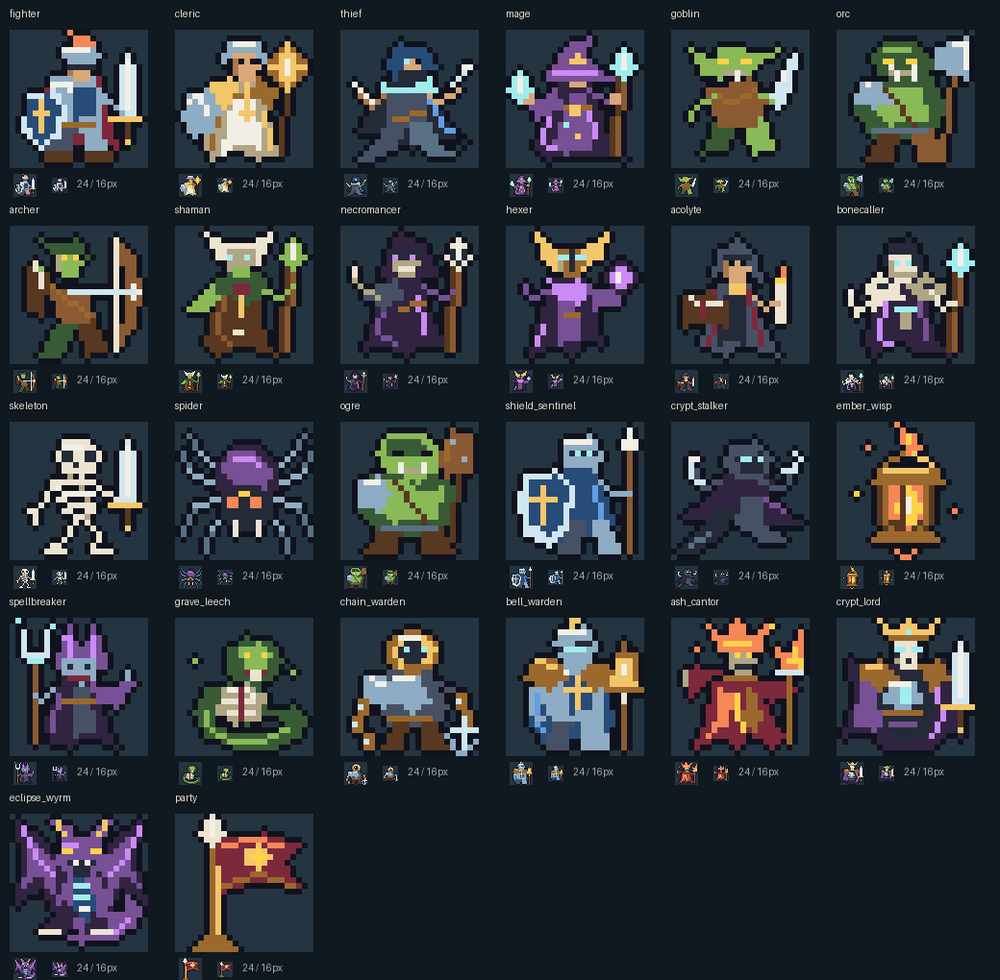

# Sprite review — build 0.19.0

All **26 sprites** have been redrawn: four heroes, 21 monsters (including four guardians), and the company standard. The overall game assessment remains **B+**. This is an editorial art improvement within a small standalone game, not a AAA certification. Earlier 0.9.0 grades did not establish the quality of the present game.

## Review findings and changes

| Finding in 0.18.0 | Implemented in 0.19.0 |
| --- | --- |
| Heads often occupied a third of the figure; bodies and robes were rectangular columns. | Smaller heads, tapered torsos, bent limbs, asymmetric stances and broken cloak hems. |
| Casters shared long vertical staffs and similar robe shapes. | Mage casts from an open hand; Hexer carries an eye-like orb; Shaman wears antlers; Acolyte reads a book; Bone Caller wears a skull mantle; Spellbreaker carries a fork beside a split mitre. |
| New specialist enemies used flat rectangular props and faces. | Sentinel has a pointed tower shield; Stalker crouches with hooked blades; Wisp hangs in a tapered lantern; Leech coils around exposed ribs; Chain Warden carries linked metal and an anchor. |
| Guardian bodies resembled enlarged ordinary troops. | Bell Warden has cathedral plate and a suspended bell; Ash Cantor has a flame crown and split burning robes; Sunless King has a broad royal mantle and cold chest light; Astrax spreads skeletal wings above a coiled tail. |
| Large pale areas and muted equipment competed with small details. | Steel, gold, eyes and spell-light are concentrated focal points, with dark keylines and shadowed undersides. |
| Company standard was an unmarked rectangle. | Forked sun banner, folded cloth, finial and weighted base. |

## Reviewed contact sheet

Each figure appears enlarged and at **24px / 16px** beneath it. Pixel details inevitably disappear on the smallest combat tiles. Names, HP, inspection labels and larger Tactics/Bestiary portraits remain authoritative.

## Scope and verification

Existing sprite IDs and registry references are unchanged. All art is authored 24×24 palette grids compiled into inline, decorative, pointer-transparent SVG. The game downloads no sprite files; the contact sheet above is repository documentation only. Heroes retain round frames, enemies square frames, and guardians their diamond/awakened indicators. Art does not alter combat rules, saves, rewards, RNG or timing.

Static checks validate geometry, palette symbols, unique artwork, registry resolution and bounded SVG. Browser checks render every monster identity on the real combat board and inspect hero/enemy shapes, HP rails, awakened guardians, matching roster/Tactics/Bestiary portraits, Effects Off and high contrast across phone portrait, short landscape, tablet and desktop. Reviewed screenshots supplement those mechanical checks; assertions do not measure aesthetic quality. Exact-head Chromium/Firefox/WebKit CI and publication evidence are recorded in the release PR.

Runtime: **403,193 bytes (393.7 KiB)**, 26 bytes smaller than 0.18.0. No runtime dependency or save-schema change. The target remains a soft 350 KiB. Physical iPhone/iPad Safari, human art-recognition studies and human campaign pacing remain unverified.

Run `node tests/sprites.cjs` and, against a local server, `node tests/sprite-browser.cjs`. The full release workflow remains mandatory.
