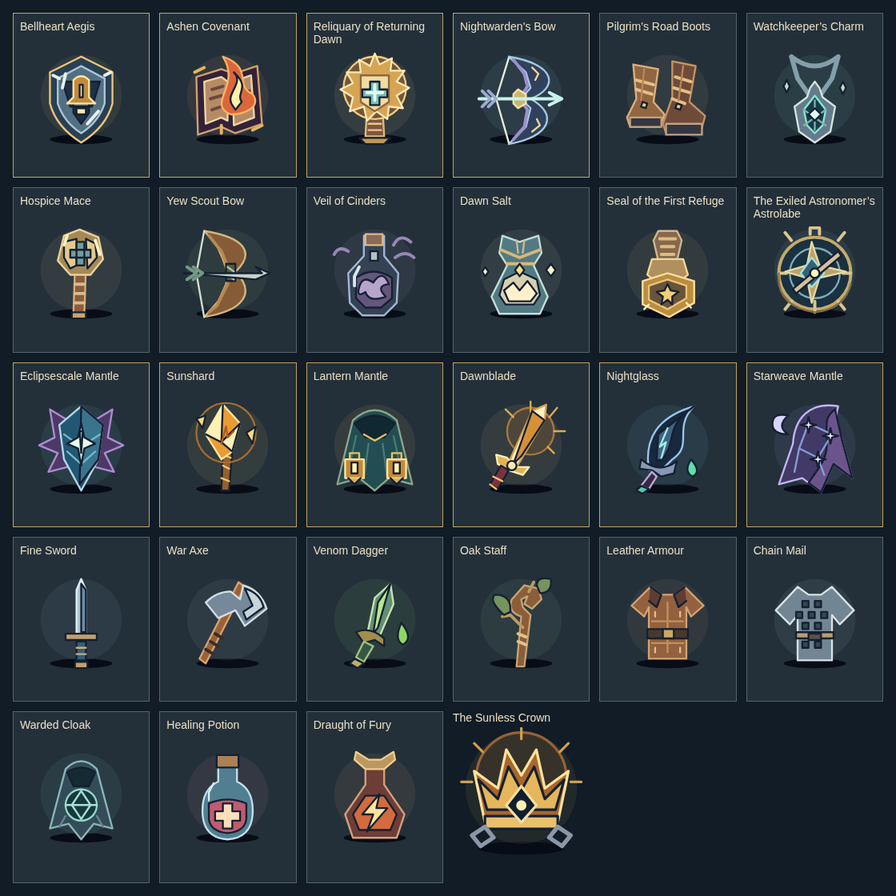

# Treasure art and acquisition review — 0.20.0

The game now has **28 individual treasure illustrations**: 27 items and the story crown. All twelve additions have unique identity-keyed geometry, not colour swaps or generic slot icons. Overall game assessment remains B+; this art pass does not certify AAA quality or physical-device recognition.

| Addition | Visual identity |
| --- | --- |
| Bellheart Aegis | Pointed steel shield, gold bell tongue, layered plate and worn highlights |
| Ashen Covenant | Split open manuscript, scorched pages, rising flame and bound spine |
| Returning Dawn | Sunburst reliquary, turquoise mercy cross, raised shrine and stepped base |
| Nightwarden’s Bow | Narrow crescent limbs, cold metal arrow, silver string and gilded grip |
| Road Boots | Unequal worn boots, stitched laces, buckles and thick soles |
| Watchkeeper’s Charm | Knotted necklace, hanging mirror shard and reflected light |
| Hospice Mace | Hollow bell head, mercy inlay, long wrapped haft |
| Scout Bow | Broad yew limbs, leaf fletching, dark grip and pale bowstring |
| Veil of Cinders | Tall stoppered glass, curling ash cloud and escaping wisps |
| Dawn Salt | Faceted tied pouch, pale mineral crystals and shrine seal |
| Refuge Seal | Weighted stamp handle, sun impression, octagonal brass foot |
| Astronomer’s Astrolabe | Concentric star circles, rotating diagonal rule and compass needle |

Reviewed the contact sheet plus real phone discovery/guide views. The discovery portrait is expandable inside Party so a long story does not bury equipment controls. The complete spoiler guide offers larger legendary displays and exact source/rule/build text. Distinctive pictures supplement names and comparisons; they do not replace readable rules. No runtime image download, SVG reference/ID, animation loop or gameplay RNG is involved.

Automated checks cover full/unique identity mappings and bounded SVG, real guarded victory → ground loot → pickup → keyboard equipment → Continue, collection history versus sales/consumption, filters, named sources, Covenant aim/charges/friendly-fire rules, consumable no-ops, four device layouts and existing game flows. Source audits measure opportunities; treasure-directed campaigns check actual acquisition under a privileged map-reading policy. Physical iPhone/iPad Safari and human recognition studies remain unverified. Full exact-head Chromium/Firefox/WebKit and publication evidence are recorded in the release PR.

Runtime: 425,380 bytes (415.4 KiB), +22,187 bytes over 0.19.0. Standalone/offline behavior and the soft 350 KiB target remain unchanged.

## Historical 0.10.1 correction

# Treasure artwork correction — 0.10.1

The 0.10.0 treasure page used one shared picture per equipment slot. That made named relics appear interchangeable, despite their different stories and rules. This release replaces those placeholders with 16 individual illustrations keyed by item identity.

| Item | Visual identity |
| --- | --- |
| Eclipsescale Mantle | Serrated dragon wings, faceted blue scale, imprisoned white star |
| Sunshard | Fractured amber crystal, floating splinters, solar ring and bound staff |
| Lantern Mantle | Deep green hood, separate folds, two illuminated hanging lanterns |
| Dawnblade | Diagonal greatsword, luminous split blade, solar halo and winged guard |
| Nightglass | Hooked midnight glass, icy facets, venom channel and gem pommel |
| Starweave Mantle | Asymmetric flowing cloth, crescent moon and linked constellations |
| Sunless Crown | Five royal tines, imprisoned dawn in a dark jewel, broken chains |
| Fine Sword | Straight steel blade, blue grip and restrained brass furniture |
| War Axe | Heavy bearded axe head, bright cutting edge and wrapped diagonal haft |
| Venom Dagger | Narrow green fang blade, poison channel and serpent-like guard |
| Oak Staff | Knotted wood, branching root, leaves and prayer bindings |
| Leather Armour | Brown leather tunic, folded collar, seams and broad buckle |
| Chain Mail | Silver sleeved silhouette, dark linked mesh and metal belt |
| Warded Cloak | Blue-green hood, circular ward and geometric protective sigil |
| Healing Potion | Rounded blue glass, red restorative liquid and pale cross |
| Draught of Fury | Angular copper flask, horned stopper and bright lightning mark |

The seven legendary/story relics receive larger 176px art stages and gold-trimmed cards. Ordinary gear retains compact portraits. The full set shares outlines, layered shading and a restrained palette; a weapon no longer becomes a different relic merely by changing its name or colour.

The artwork is authored inline SVG. A small path builder removes repeated XML syntax; all 16 SVG outputs were compared before and after compaction and remained byte-for-byte identical. No external images, SVG ID references, animations, game-state or RNG changes were added. Item effects, sources and ownership are unchanged. The runtime is **356,903 bytes**, below the **358,400-byte / 350 KiB** budget.

Reviewed a 16-item contact sheet and the actual 440×780 treasure page. Dependency-free checks enforce complete mappings, unique path geometry independent of colour and decorative local SVG. Browser checks cover all 16 art identities, seven larger relic displays, unclipped 64×64 geometry, pointer transparency, search/filter/ownership and both atlas sections at phone, landscape, tablet and desktop sizes. Existing engine, device, story, hunt and balance gates remain required; final workflow/publication evidence is recorded in the implementation PR.

The review demonstrates distinct, legible item illustrations within the standalone budget. It does not establish commercial AAA production quality or physical iPhone/iPad certification.
